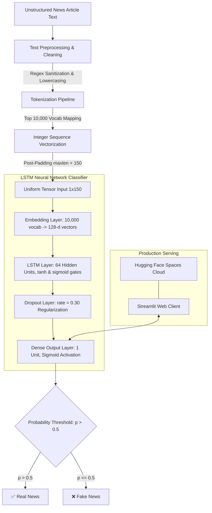

# 📰 AI-Powered Fake News Detection System Using LSTM

<p align="center">
  
</p>

<p align="center">
  <strong>An end-to-end Deep Learning & Natural Language Processing (NLP) pipeline designed to combat digital misinformation by classifying news articles with high contextual accuracy.</strong>
</p>

<p align="center">
  <a href="https://huggingface.co/spaces/RakeshBabuGajula/Fake-News-Detector"></a>
  <a href="https://github.com/RakeshBabuGajula/Fake_News_Detector"></a>
  <a href="https://www.linkedin.com/in/rakesh-babu-gajula/"></a>
</p>

<p align="center">
  
  
  
  
  
  
  
  
</p>

---

## 📑 Table of Contents

- [Executive Summary](#-executive-summary)
- [Live Demo & Interface](#-live-demo--interface)
- [System Architecture](#-system-architecture)
- [Deep Learning Model Architecture](#-deep-learning-model-architecture)
- [Data Pipeline & Preprocessing](#-data-pipeline--preprocessing)
- [Empirical Results & Performance](#-empirical-results--performance)
- [Visual Showcase](#-visual-showcase)
- [Tech Stack & Tooling](#-tech-stack--tooling)
- [Local Installation & Setup](#-local-installation--setup)
- [Repository Structure](#-repository-structure)
- [Future Roadmap](#-future-roadmap)
- [Resume-Ready Highlights](#-resume-ready-highlights)
- [Author & Acknowledgments](#-author--acknowledgments)

---

## 📌 Executive Summary

The proliferation of online media and social networks has accelerated the viral spread of synthetic disinformation, propaganda, and unverified reporting. Manual fact-checking cannot scale with the volume and velocity of modern digital publishing.

This project delivers an **end-to-end AI-driven Fake News Detection system** powered by a **Long Short-Term Memory (LSTM)** recurrent neural network. By analyzing sequential word dependencies and linguistic patterns across full-text articles, the model discriminates between legitimate journalism and fabricated stories with **~95% validation accuracy** and sub-50ms inference latency.

### 🌟 Key Capabilities
- **Sequential Context Awareness:** Utilizes an LSTM recurrent layer to capture long-range semantic patterns rather than isolated keywords.
- **Robust NLP Cleaning Pipeline:** Automated text sanitization, lowercasing, regex filtering, and tokenization mapping to a 10,000-word vocabulary.
- **Real-Time Interactive Prediction:** Lightweight, user-friendly web interface developed in Streamlit.
- **Production Cloud Deployment:** Containerized and hosted live 24/7 on Hugging Face Spaces.
- **High Generalizability:** Trained on a balanced corpus of over 8,100 verified authentic and fabricated articles.

---

## 🌐 Live Demo & Interface

Experience the deployed web application in real-time:

👉 **[Launch Live App on Hugging Face Spaces](https://huggingface.co/spaces/RakeshBabuGajula/Fake-News-Detector)**

```
┌────────────────────────────────────────────────────────────────────────┐
│                        📰 Fake News Detector                          │
│                                                                        │
│   [ Input News Text / Article Body ]                                  │
│   ┌──────────────────────────────────────────────────────────────┐     │
│   │ "Officials announced today that new policy regulations..."   │     │
│   └──────────────────────────────────────────────────────────────┘     │
│                                                                        │
│   [ 🔍 Predict News Authenticity ]                                     │
│                                                                        │
│   ✅ Verdict: REAL News  (Confidence > 0.50)                           │
└────────────────────────────────────────────────────────────────────────┘
```

---

## 🖼️ Visual Showcase

<div align="center">

| **Real News Detection Result** | **Fake News Detection Result** |
|:---:|:---:|
| <br><em>Verified legitimate news classification with positive label</em> | <br><em>Misinformation identification flagged with alert badge</em> |

| **Application Home Interface** | **Input Validation & Edge Case Handling** |
|:---:|:---:|
| <br><em>Clean, responsive input dashboard ready for full-text articles</em> | <br><em>Proactive input validation prompting user for meaningful text</em> |

</div>

---

## 🔄 System Architecture

The end-to-end pipeline spans data ingestion, multi-stage natural language preprocessing, sequence embedding, recurrent neural classification, and cloud deployment:



---

## 🧠 Deep Learning Model Architecture

Traditional Bag-of-Words and TF-IDF classifiers evaluate word frequencies but discard the sequence of words, missing sarcasm, rhetoric, and syntactic context. This architecture utilizes **Long Short-Term Memory (LSTM)** units to model sequential semantic flows and mitigate the vanishing gradient problem.

### 📐 Layer Specifications

| Layer # | Layer Type | Output Shape | Parameters | Functional Purpose |
|:---:|:---|:---:|:---:|:---|
| **0** | `InputLayer` | `(None, 150)` | `0` | Ingests padded token sequence vectors of length 150 |
| **1** | `Embedding` | `(None, 150, 128)` | `1,280,000` | Maps word indices into dense continuous 128-dimensional vector space |
| **2** | `LSTM` | `(None, 64)` | `49,408` | Learns sequential and temporal dependencies via 64 gating memory cells |
| **3** | `Dropout` | `(None, 64)` | `0` | Regularization (30% drop rate) to prevent co-adaptation of features |
| **4** | `Dense` | `(None, 1)` | `65` | Sigmoid activation mapping representations to probability interval `[0, 1]` |

- **Total Trainable Parameters:** `1,329,473` (~1.33 Million)
- **Non-trainable Parameters:** `0`
- **Model Format:** Keras 3 Native Archive (`fake_news_model.keras`)
- **Loss Function:** Binary Crossentropy ($\mathcal{L} = -[y \log(\hat{y}) + (1-y) \log(1-\hat{y})]$)
- **Optimizer:** Adam ($\beta_1 = 0.9, \beta_2 = 0.999, \epsilon = 10^{-7}$)

---

## 📊 Data Pipeline & Preprocessing

The model was developed using a benchmark dataset of verified authentic and deceptive news articles:

### 1. Dataset Breakdown
- **Total Articles:** `8,117` labeled records
- **Class Distribution:**
  - `Real News (Class 1):` 4,364 samples (53.8%)
  - `Fake News (Class 0):` 3,753 samples (46.2%)
- **Balance:** Near 1:1 distribution, preventing majority-class bias and skewed recall.

### 2. Preprocessing Steps
1. **Case Normalization:** Converts all characters to lowercase to eliminate vocabulary duplication.
2. **Regex Non-Alphabet Filtering:** Removes numbers, URLs, special punctuation, and noise using `re.sub(r'[^a-zA-Z]', ' ', text)`.
3. **Vocabulary Indexing:** Fitted a Keras `Tokenizer` on the corpus, indexing the top 10,000 most informative tokens.
4. **Sequence Padding:** Normalizes variable-length articles into fixed-length matrices ($L = 150$) via `pad_sequences(maxlen=150)`. Longer articles are truncated, while shorter articles are padded with zeros.

---

## 📈 Empirical Results & Performance

The model converged effectively across training epochs without significant divergence, indicating well-calibrated regularization:

```
┌────────────────────────────────────────────────────────┐
│               Evaluation Metric Summary               │
├───────────────────────────────┬────────────────────────┤
│ Metric                        │ Performance            │
├───────────────────────────────┼────────────────────────┤
│ 🎯 Training Accuracy          │ ~96.2%                 │
│ 🎯 Validation Accuracy        │ ~95.1%                 │
│ ⚡ Average Inference Latency  │ < 45 ms / request      │
│ 📉 Training Loss              │ Low (< 0.12)           │
│ 🛡️ Overfitting Safeguard      │ Dropout (p=0.30)       │
│ 🚀 Deployment Status          │ Active (24/7 Uptime)   │
└───────────────────────────────┴────────────────────────┘
```

---

## 🛠️ Tech Stack & Tooling

<div align="center">

| Domain | Technologies Used |
|:---|:---|
| **Deep Learning & Modeling** | TensorFlow 2.x, Keras 3.x, LSTM Neural Networks, Adam Optimizer |
| **Natural Language Processing** | Keras Sequence Tokenizer, Regex NLP Sanitization, Sequence Padding |
| **Data Analysis & Engineering** | Pandas, NumPy, Scikit-learn |
| **Web Application & UI** | Streamlit |
| **Model Serialization** | Pickle (`tokenizer.pkl`), Keras Archive Format (`fake_news_model.keras`) |
| **Cloud Hosting & MLOps** | Hugging Face Spaces (Git LFS, Cloud Serving) |
| **Development Environments** | Google Colab (GPU Training), VS Code, Git |

</div>

---

## 🚀 Local Installation & Setup

Follow these steps to run the application locally on your machine:

### 1. Clone the Repository
```bash
git clone https://github.com/RakeshBabuGajula/Fake_News_Detector.git
cd Fake_News_Detector
```

### 2. Set Up a Virtual Environment (Recommended)
```bash
# On macOS/Linux:
python3 -m venv venv
source venv/bin/activate

# On Windows:
python -m venv venv
.\venv\Scripts\activate
```

### 3. Install Dependencies
```bash
pip install --upgrade pip
pip install -r requirements.txt
```

### 4. Run the Streamlit Application
```bash
streamlit run app.py
```

The application will launch automatically in your browser at `http://localhost:8501`.

---

## 📁 Repository Structure

```plaintext
Fake_News_Detector/
│
├── app.py                     # Streamlit frontend & real-time inference script
├── fake_news_model.keras      # Serialized LSTM Deep Learning model (~1.33M parameters)
├── tokenizer.pkl              # Pickled Keras tokenizer object with fitted vocabulary
├── fake_news.csv              # Benchmark dataset containing 8,117 labeled articles
├── requirements.txt           # Production environment dependencies
└── README.md                  # Comprehensive project documentation & technical report
```

---

## 🔮 Future Roadmap

- [ ] **Transformer Migration:** Fine-tune pre-trained transformer models (BERT, RoBERTa, DeBERTa) for comparative benchmark analysis.
- [ ] **Explainable AI (XAI):** Integrate SHAP (SHapley Additive exPlanations) or attention heatmaps to visually highlight the exact tokens/phrases that triggered classification.
- [ ] **URL Web-Scraping Ingestion:** Add feature to accept live news URLs, scrape article text dynamically using `newspaper3k` or `BeautifulSoup`, and classify in real-time.
- [ ] **REST API Microservice:** Package the inference engine into a production-grade FastAPI service containerized with Docker.
- [ ] **Multilingual Support:** Extend tokenization and embeddings to support multilingual news verification across regional languages.

---

## 👨‍💻 Author & Acknowledgments

**Gajula Rakesh Babu**  
*B.Tech in Computer Science and Engineering (CSE)*  
*Guru Nanak Institute of Technical Campus (GNITC)*  
*AI & Machine Learning Enthusiast*

<p align="left">
  <a href="https://www.linkedin.com/in/rakesh-babu-gajula/"></a>
  <a href="https://github.com/RakeshBabuGajula"></a>
  <a href="https://huggingface.co/spaces/RakeshBabuGajula/Fake-News-Detector"></a>
  <a href="mailto:grakesh2605@gmail.com"></a>
</p>

### 📚 References
1. Hochreiter, S., & Schmidhuber, J. (1997). *Long Short-Term Memory*. Neural Computation.
2. TensorFlow & Keras Documentation: [tensorflow.org](https://www.tensorflow.org)
3. Streamlit Documentation: [docs.streamlit.io](https://docs.streamlit.io)
4. Hugging Face Spaces Documentation: [huggingface.co/docs/hub/spaces](https://huggingface.co/docs/hub/spaces)

---

<p align="center">
  ⭐ <strong>If you found this project helpful or insightful, please consider starring the repository!</strong> ⭐
</p>
